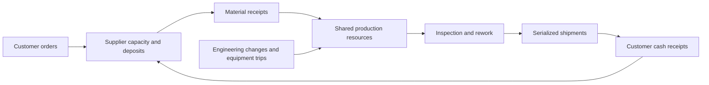

# OtisBench

**Can an AI agent keep a factory delivering when every decision carries forward?**

[Explore the tracks](#ten-evaluation-tracks) · [Enter the production marathon](#the-production-marathon) · [Work through a judgment case](docs/manufacturing-judgment.md) · [Run your agent](#get-started)

OtisBench puts frontier AI through a comprehensive manufacturing gauntlet: **engineer the product, secure the material, coordinate production, clear quality, ship conforming units, and keep the operation funded.** Ten evaluation tracks connect engineering precision, operational execution, business judgment, and factory economics.

The flagship challenge is a persistent plant campaign: **up to 96 customer orders, a 48-shift horizon, and 23,040 agent decisions**. Machines, people, fixtures, material, supplier capacity, and cash compete across the same episode. Earlier decisions shape what the agent can do next.

**The manufacturing environment models eight connected systems: ERP, MES, SCM, WMS, PLM, QMS, CMMS, and HR.** Agents read business records and execute actions that change orders, inventory, production, quality, maintenance, and supplier commitments.

Its depth comes from connected decisions: engineering changes affect production, material holds affect fulfillment, maintenance consumes scarce stock, and customer shipments finance later work. Agents must manage those dependencies while the plant keeps changing.

| Scale | Coverage |
|---|---|
| **32 manufacturing routes** | Machining, fabrication, casting, plastics, electronics, assembly, surface treatment, and batch processing |
| **1,024 manufacturing workflows** | 32 routes × 16 disruption contracts × 2 parameter draws |
| **128 persistent campaigns** | Four operating horizons across all 32 routes |
| **Up to 96 customer orders per campaign** | Shared machines, labor, fixtures, inventory, supplier capacity, and cash |
| **Up to 23,040 agent decisions** | A 48-shift manufacturing horizon with consequences that persist across orders |
| **12 judgment workflows · 36 decision rounds** | Evolving evidence, competing priorities, and recommendations that must withstand review |

## Inside the challenge

A customer order needs material that has just entered quality hold. Replacement supply ties up cash before it arrives. The machine has enough tool life for the next batch, but its operator’s qualification will expire. An engineering change arrives while earlier work is in progress. The agent must get the next decision right and carry its consequences through production, inspection, and delivery.

These pressures arise through the workflow and campaign contracts. The workload combines process calculations, resource scheduling, approval-bound actions, evolving records, and recovery from interrupted work.

## What OtisBench puts to the test

**Engineering precision.** Derive process settings, interpret drawings, construct CAD solids, analyze raw sensor evidence, and reconcile commercial documents.

**Execution across the factory.** Source eligible material, secure approvals, schedule qualified resources, run production, recover work in progress, clear quality, and deliver traceable product.

**Sustained operational control.** Carry a plant through successive orders with finite tooling, maintenance spares, supplier dispatch windows, deposits, delayed receivables, and a shared treasury.

**Adaptation under pressure.** Respond to drawing changes, equipment trips, held lots, failed inspections, expiring qualifications, and shifting customer needs while earlier commitments remain in force.

**Manufacturing judgment.** Defend allocation, sourcing, maintenance, investment, negotiation, and recovery decisions as new evidence arrives. Reviewers assess the quality of the tradeoffs and revisions.

**Inspectable outcomes.** Retain action traces, inspect the resulting business state, reconcile physical and financial ledgers, and replay execution. Each track measures the output its task actually requires.

## The production marathon

Take one plant through **96 customer work orders** in a persistent agent episode. The largest profile has a **48-shift manufacturing horizon** and a budget of **23,040 agent decisions**. Smaller profiles cover 12, 24, and 48 orders.

Orders compete for machines, labor, fixtures, tooling, supplier dispatch slots, and cash. A material commitment locks a deposit. Customer shipments fund later work through delayed payments. Repairs require kits that must actually arrive. Preventive service can avert equipment trips, but consumes the same scarce kits, cash, and production time. Engineering changes and equipment trips continue as new orders enter the plant.

The agent must keep production moving, protect material eligibility, maintain resources, recover interrupted WIP, clear quality, and meet every customer window. Waiting for all future changes misses the first deadline. Buying every supply lot on the fastest service runs into shared dispatch capacity.



**128 campaigns = 32 manufacturing routes × 4 operating horizons.** [Campaign contracts, tools, and recovery →](docs/production-campaigns.md)

## A complete manufacturing workflow

1. Reconcile the customer order, drawing revision, material specification, quantity, and delivery date.
2. Source and reserve eligible material across lots; account for supplier certificates, ownership, holds, and receipt times.
3. Derive process controls and select machines, operators, tools, and calibrated fixtures.
4. Execute the route with finite capacity, resource bookings, irreversible material consumption, and work in progress.
5. Recover from breakdowns, engineering changes, expired qualifications, delayed supply, and failed inspection.
6. Obtain action-bound approvals, perform authorized rework, release quality, and ship serialized finished goods.

Reading records and writing a plan do not fulfill an order. The score follows the product: completed operations, conforming release, actual shipments, genealogy, deadline, budget, and authorization.

## Built for difficult operational decisions

**Evidence changes while the agent works.** A reserved lot can enter quality hold. A drawing revision can invalidate process settings and approvals. A machine can trip during production, leaving interrupted WIP that must be recovered without consuming material twice.

**Resources interact.** A qualified machine still needs a qualified operator, an available fixture, enough tool life, a feasible batch size, and an operating window. Premium alternatives, replacement material, calibration, and rework compete for one production budget.

**Numerical mistakes have consequences.** Agents derive spindle speed and feed, thermal soak, welding heat input, clamp force, concentration, residence speed, or unit energy. Incorrect settings can execute and produce a failed inspection.

**Recovery requires execution.** A nonconformance needs disposition, exact-quantity rework, approval, and a new measurement. Outside processing needs a matching certificate. Shipment requires released serials allocated to the right customer order.

## Manufacturing coverage

| Process group | Routes |
|---|---|
| Machining and fabrication | Precision CNC, turned shafts, sheet fabrication, weldments, gears, hydraulic cylinders |
| Materials and forming | Sand casting, die casting, injection molding, extrusion, rubber molding, composites |
| Electronics and electrical | PCB assembly, cable harnesses, battery modules, semiconductors, motors |
| Surface and thermal processing | Heat treatment, electroplating, anodizing, powder coating |
| Mechanical assembly | Bearings, pumps, valves |
| Process and batch production | Food, chemical blending, tablets, textiles, glass, ceramics |
| Other production | Metal additive manufacturing, packaging |

[All 32 routes, 16 disruptions, and workflow scoring →](docs/manufacturing-workflows.md)

## Ten evaluation tracks

| Track | Catalog | What the agent delivers |
|---|---:|---|
| Production campaigns | 128 campaigns · 12–96 orders each | Sustained fulfillment across a shared plant |
| Manufacturing workflows | 1,024 cases · 32 routes · 16 disruptions | Conforming, traceable customer shipments |
| Engineering | 84 cases · 42 families | Manufacturing calculations and constrained decisions |
| Supply chain | 96 cases · 24 families | Reconciled, approved, posted business decisions |
| Procure to pay | 48 episodes · 12 disruption contracts | Linked purchasing, receipts, quality, invoices, and payments |
| Sensor analysis | 48 cases · 12 families | Evidence-based diagnoses and operating decisions |
| Procurement documents | 32 packets · 8 contracts · 2 draws · 2 PDF modes | Reconciliation with document and page evidence |
| CAD and drawings | 72 cases · 12 part families · 3 evidence modes · 2 draws | Executable solids checked with OpenCascade |
| Enterprise execution | 58 tasks · 18 families | Completed changes across connected business systems |
| Factory seasons | 12 seasons · 26 weeks each | Purchasing, production, maintenance, fulfillment, and profit |

Each track keeps its own metrics. [Track contracts and scoring →](BENCHMARK_CARD.md)

## Advanced manufacturing tiers

- **Temporal recovery — 64 workflow variants.** Engineering releases, equipment trips, and quality dispositions arrive on separate schedules. Shared-fixture bookings, expiring qualifications, and tight customer deadlines make timing part of the solution. [Temporal tier →](challenges/README.md)
- **Material networks — 48 cases across 8 graph families.** Parallel branches, reconvergent flows, nested and shared subassemblies, co-products, recycling, and inter-site transfers execute against stock, mass, cash, and resource ledgers. [Material networks →](docs/manufacturing-networks.md)
- **Replenishment — 128 cases across 16 planning contracts.** Supplier capacity, MOQ, pack sizes, split sourcing, deposits, landed costs, and component-to-shipment allocation. [Replenishment →](docs/replenishment.md)
- **Measurement and document extensions.** Hydraulic condition monitoring, photographed visual inspection, supplier scans, and Odoo-backed ERP compatibility connect operational decisions to their source evidence. [Extension guide →](docs/extensions.md)

These tiers have separate catalogs and entry points in the source checkout.

## Manufacturing judgment

**12 workflows · 36 decision rounds** cover supplier recovery, defect investigation, maintenance strategy, customer allocation, engineering cutover, escalation, capital investment, supplier development, shift handover, cross-site transfer, process trials, and negotiation.

Commit a recommendation, receive new evidence, and revise the plan. Several choices can be defensible. Evidence and submission checks remain explicit; reviewers assess the quality of tradeoffs, feasibility, communication, and adaptation. No answer or preferred plan is supplied. [Work through the judgment workshops →](docs/manufacturing-judgment.md)

## The agent supplies the solution

Agents receive a neutral fulfillment goal, tool contracts, and observable business records. The agent chooses every action and submits every calculated value. Workflow identifiers are opaque per episode. Worked formulas, scenario labels, reference plans, evaluator annotations, expected values, and live scores stay outside the workflow agent transport.

The evaluator uses reference calculations to check submitted controls; it never fills them in for the agent. Inspection results describe work already performed.

## Get started

```bash
git clone https://github.com/Faraday-Cage-AI/OtisBench.git
cd OtisBench
python3 -m venv .venv
source .venv/bin/activate
python -m pip install -e '.[dev]'

# Inspect the catalog and export the agent's startup contract.
otisbench list --track workflow
otisbench show mfg-flow-pump_assembly-16-01
otisbench export-agent --task mfg-flow-pump_assembly-16-01 --output agent-input.json
```

Run a long production campaign with your own agent:

```bash
otisbench campaign \
  --task campaign-pump_assembly-forty_eight_shift \
  --agent-command 'python /absolute/path/to/my_agent.py' \
  --output runs/pump-campaign.json
```

Run a selected individual workflow:

```bash
otisbench workflow   --task mfg-flow-pump_assembly-16-01   --agent-command 'python /absolute/path/to/my_agent.py'   --output runs/pump-recovery.json

otisbench replay runs/pump-recovery.json
```

The agent is a persistent JSONL process. Read one decision from stdin and write one action to stdout:

```json
{"tool":"read","arguments":{"system":"ERP"}}
```

Keep logs on stderr. Workflow episodes allow up to 240 tool calls and 2,400 manufacturing minutes. The runner saves transitions and terminal checks; replay verifies recorded actions, results, and state hashes.

For offline standalone Python agents on macOS, `otisbench isolated` stages the agent file and enforces OS restrictions on evaluator-file access, network use, and subprocesses. Ordinary `--agent-command` launches provide the JSONL transport. See [agent integration and isolation](docs/agent-isolation.md).

Optional dependencies: `.[cad]` for solid evaluation, `.[documents]` for document tooling, `.[real-data]` for measurement extensions, and `.[openai]` for provider integration. The `mfg-bench` command and existing `faraday-manufacturing/1` wire protocol remain supported.

## Design comparison

[LarkBench](https://larkagents.com/blog/larkbench/article.html) studies recurring distributor purchasing. [ICCA Bench](https://oroagents.com/benchmarks/icca-bench) studies adaptation to delayed consequences at a wholesale buying desk. **OtisBench puts the manufacturing operation itself at the center:** engineering inputs, material transformation, finite production resources, work in progress, quality release, serialized fulfillment, and shared cash.

Its breadth comes from ten evaluation tracks, 32 production routes, persistent multi-order campaigns, and a separate workshop set for manufacturing judgment. [Benchmark scope and design →](docs/benchmark-landscape.md)

## Development

```bash
python -m pytest tests/test_otisbench.py tests/test_agent_boundary.py tests/test_shopfloor.py tests/test_campaign.py tests/test_campaign_logistics.py -q
python scripts/build_manifest.py --check
```

These commands check package identity, task contracts, action invariants, agent-input boundaries, and release fingerprints. Benchmark episodes and provider calls start only through explicit run commands.

Code: [Apache-2.0](LICENSE). Task content: [CC BY 4.0](DATA_LICENSE). [Methodology](docs/methodology.md) · [Attribution](NOTICE).
